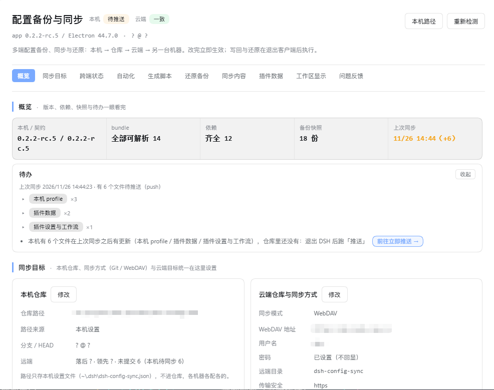

# Config Backup & Sync

> **dsh-profile-config-sync** — multi-device configuration **backup / sync / restore** for the DeepSeek Harness desktop client.

[](https://www.npmjs.com/package/dsh-profile-config-sync)
[](https://github.com/huanyu-a/dsh-profile-config-sync/releases/latest)
[](LICENSE)
[](#sync-scope)
[](#sync-scope)
[](https://github.com/huanyu-a/dsh-profile-config-sync/blob/main/docs/CHANGELOG.md)

[中文](README.md) | English

DSH keeps its configuration in a dozen places under `~/.dsh`: the profile, the global prompt, skills, agent presets, plugin settings, plugin data, workspaces and session logs.
This plugin captures them as **12 groups** into one Git repository, pushes it to your own Git remote or a WebDAV endpoint, and lays it back down on another machine — or after a reinstall, or after a bad edit.
**Every sync runs after the client has exited**, so a half-written config never reaches the repo.

Based on [QcWyGm/dsh-config-sync-plugin](https://github.com/QcWyGm/dsh-config-sync-plugin) (MIT) — rewritten and extended; see [Upstream & license](#credits).



---

## What it does

- **Captures 12 groups**: profile files, global prompt (`AGENTS.md` / `prompt-inject.md`), skills, agent presets, the skill-market ledger, plugin settings & workflows (14 sources), memory data, local source plugins, plugin-data slots, extra paths, workspaces and session logs (attachments and `session_projcache` included). Every group and item can be switched off; anything that could not be captured is named at the end of the log and in a persistent panel notice.
- **Two transports**: Git remotes (SSH / HTTPS — GitHub, Gitee, GitLab, self-hosted Gitea/Forgejo) and **WebDAV**, sharing one repository layout, switchable at any time.
- **Four actions, one-click scripts**: push, pull, restore (a snapshot or a git commit) and init-push, each generated as a double-clickable `.cmd` (Windows) or `.sh` (macOS/Linux).
- **Runs after the client quits**: nothing is copied while the app is running; actions can queue for the next launch, and auto-sync can relaunch the client itself.
- **No forked repository across platforms**: PowerShell on Windows, the Node engine on macOS/Linux, one shared repo; machine identity lives in `machines/`.
- **Backs up before overwriting**: files about to be replaced or deleted go to `~/.dsh/backups/` first, so a wrong restore can itself be rolled back.
- **Panel health check**: local / cloud badges (cloud re-checked every two minutes), version contract, bundle, dependencies, backup snapshots, last sync, and a to-do list with jump links.
- **Safety boundaries**: browser profiles and credential stores are blocked at three independent layers (capture, upload, engine); three per-file size tiers (>100 MB skipped at capture, ≥95 MB dropped before commit, 50–95 MB warn only); both sides of a conflict are kept; path-traversal guards.
- **Pending counts match the executor**: 12 groups on Windows, only the four groups the engine really syncs on macOS/Linux.
- **Self-update**: reads the `version.json` manifest and checks / downloads / installs from the panel.

**Four keywords**: **configure** · **back up** · **sync** · **restore**.

---

## Install

Package name **`dsh-profile-config-sync`** (the npm package `dsh-config-sync` is the *upstream* project, not this one).

| Method | Entry |
|---|---|
| npm | `npm i dsh-profile-config-sync` — **npm only has `0.4.1`**, without the 0.6.x safety fixes |
| Plugin market | Search “Config Backup & Sync” in the client's plugin market (via the git commit registered in `market-index.json`) |
| Offline tgz | `pnpm add ./dsh-profile-config-sync-0.6.44.tgz` |

**Release status**: the latest release is [`v0.6.44`](https://github.com/huanyu-a/dsh-profile-config-sync/releases/tag/v0.6.44) (2026-11-27); the repository is public and the npm package publishes alongside (`npm i dsh-profile-config-sync`).

## HTTP route admission

Every `/config-sync/*` route asks the Host Connection before the handler runs:
`ctx.connection.requestRejection(request)` — DSH's own Host/Origin fence plus browser-session authentication,
the same gate the GUI's `/api` channel uses. Only when the Host offers no `connection` service does the plugin fall
back to its own `originAllowed` (loopback Host, cross-site and `Sec-Fetch-Site: cross-site` refused).

**Why this layer exists**: `webServer.register` is a bare HTTP carrier — the DSH docs say the carrier "owns no
authentication or Origin policy", so route authentication belongs to the composition. Through 0.6.41 the plugin relied
only on its own `originAllowed`, which treats a request without an `Origin` header as trustworthy; a bare
`curl http://127.0.0.1:<port>/config-sync/status` (the Host port changes on every start; read `DSH_WEB_URL`) returned **200** and exposed repo paths, config digests and the pending
list, and could trigger push or restore. The same request now answers **401**, and a refusal body carries only
`{ ok: false, error: "unauthorized" | "forbidden" }` — no business fields.

Because the gate depends on `requestRejection` / `connection.fetch`, `package.json` declares `engines.dsh: ">=0.2.2-rc.5"`.
The floor is measured, not guessed: the admission APIs already exist in 0.2.2-rc.5 (`requestRejection` / `admit` in
`dsh-client-connection/src/rpc-host.ts`), while DSH enforces `engines.dsh` at install and at profile startup — a fake
plugin declaring `>=99.0.0` is refused with `incompatible-version` on a scratch profile — so `>=0.2.3` would lock out the
machine currently running 0.2.2-rc.5. Once the runtime moves to 0.2.3+, the floor can be tightened in one line.

## Known limits

- **No mutex off Windows**: Windows capture/apply use a named mutex (`Lock-SyncRun`, exit code 3 for a second runner); the macOS/Linux engine has no such lock.
- **The non-Windows engine covers 4 groups**: profile, global prompt, skills, presets. Sessions, plugin data and extra paths need the Windows build.
- **Browser profiles never enter the repo**: `browser-profiles`, `Login Data`, `Cookies` and friends are blocked at three layers.

---

## Quickstart

Push once on machine A, pull once on machine B.

```
Machine A ──────────────────────► remote (Gitee / GitHub / self-hosted) ──────► Machine B
1 install the plugin                                                          1 install the SAME client version, launch once
2 panel: local repo + cloud URL                                               2 install the plugin, same local repo + cloud URL
3 click "init push"                                                           3 click "pull" (overwrites local config)
```

| Prerequisite | Requirement | Otherwise |
|---|---|---|
| Client version | **identical** on both machines (`profile\host-contract.json`) | pull reports a version mismatch; `-AllowVersionDrift` forces it |
| Target `.dsh` | the client has been launched at least once | `[X] target profile does not exist`, pull exits |
| Built-in runtime | `<AppRoot>\node.exe` or the client binary | sessions' `cwd` cannot be rewritten — **the session list will be empty** |
| git | installed on both sides | `git.exe not found` |

CLI equivalent (the panel buttons do exactly this):

```powershell
pwsh -File runtime\sync.ps1 push -RepoRoot <repo> -DshHome <~\.dsh> -AppRoot <client root> -SkipInstall -Force
pwsh -File runtime\sync.ps1 pull -RepoRoot <repo> -DshHome <~\.dsh> -AppRoot <client root> -SkipInstall -Force
```

`-SkipInstall` skips `pnpm install` (required offline); `-Force` bypasses the “DSH is running” guard (quit the client instead).

Details, raw first-push/first-pull output and the five classic pitfalls: [docs/REFERENCE.md](docs/REFERENCE.md#fromscratch).

## Where the entries hang

| Entry | Slot | Notes |
|---|---|---|
| Sidebar row | `sidebar.panellist` (`id: config-sync`) | Title “Config Backup & Sync” |
| Full page | `main` (`key: config-sync`) | Both registers must happen in a nested `inject` |
| Settings summary | `settings.general.item` | One four-state chip + expandable detail |

## What the panel shows

- **Title row**: local badge (consistent / pending push / pending pull / problem) and cloud badge (re-checked automatically every two minutes).
- **Metric strip**: local/contract, bundle, dependencies, backup snapshots, last sync (with `(+N)` for later writes); a to-do list appears only when something needs attention.
- **Sections**: overview → local paths (hidden by default) → conflicts (only when real) → sync targets → automation & updates → after-exit actions → restore → sync scope → feedback.
- **Every card is read-only until you press Edit**; a never-configured card is forced into edit mode.
- **“Pending push” is not just `git status`**: the host compares mtimes across all 12 captured groups, so a new session that has not been captured yet still counts (capped at 20,000 files / 1.5 s).

## Local repo / cloud repo

- **Repo test**: `apply.ps1` plus `profile\package.json` present (plus `sync.ps1` to push/pull).
- **Resolution order**: settings file → `repoPath` → `DSH_CONFIG_REPO` → common locations. An empty directory in the settings is still a valid answer.
- **Four states**: `ok`, `empty` (await first pull), `missing`, `unusable`.
- **Empty local + cloud has content → pull only**; **both empty → init push only**.
- Cloud emptiness is probed with `ls-remote` + a shallow bare fetch (15 s timeout); unreachable means “pull only”.
- Settings live in `~\.dsh\dsh-config-sync.json` (machine-local, never committed); the SSH key path is stored, but may be left empty for `.ssh\config`.

## Sync scope

All **12 groups are checked by default**; each group and each item can be unchecked, and unchecking stops both capture and restore.

| Group | Cloud dir | Items |
|---|---|---|
| profile | `profile/` | package.json / lock / cordis (mandatory, cannot be unchecked) |
| prompt | `prompt/` | `AGENTS.md`, `prompt-inject.md` |
| skills | `skills/` | one directory per skill |
| presets | `presets/` | one entry per preset |
| market ledger | `storages-record/` | two ledger JSON files |
| plugin settings | `settings/` | 13 files |
| memory | `mnemon/` | the whole directory |
| local plugins | `local-plugins/` | one per linked plugin |
| plugin data | `plugin-data/` | one slot per plugin-owned directory |
| extra paths | `extra/` | absolute paths you add |
| workspaces | `workspace/` | every registered workspace |
| sessions | `conversations/` | logs, attachments and projcache |

Scope is stored in `~\.dsh\config-sync-scope.json` (machine-local, only the deltas). An optional switch also deletes the cloud copy when you uncheck something — off by default.

## Restore

- The restore card lists every snapshot in `~\.dsh\backups` with name, time, plugin count and whether it is restorable (no per-snapshot `stat` sweep — that used to take 7.7 s for 92 snapshots).
- **“Restore now”** is a flow: diff preview → confirm → the client quits normally → `post-exit.ps1` runs `restore.ps1` in a visible window → result written to `auto-sync-result.json` → the client relaunches. No manual `.cmd`, no typing `y`.
- **Point-in-time restore** moves newer files into `backups\manual-<ts>\rollback\` and records everything in `rollback-manifest.json`, so the rollback itself can be rolled back.
- Three backup kinds each get a button: config snapshots, plugin backups, session backups; unrecognised directories offer a manual path instead of a dead button.

## Sync conflicts

1. `sync.ps1 pull` fetches, checks fast-forward, then intersects changed paths with local modifications. On a hit it **backs up both sides**, writes `~\.dsh\sync-conflicts.json` and exits 6 — repository and config untouched, HEAD not reset.
2. The panel shows a conflict card: one row per file, expandable previews, “use local / use cloud” per row (plus both-all buttons), and “restore local/cloud copy” from the backup.
3. Applying the choice deletes the working copy so git can fast-forward, then writes the local picks back as a normal local change.

## Auto sync (both switches off by default)

- **Auto pull on start**: 8 s after launch a read-only `git fetch` decides; if behind, a confirm dialog, then the whole client family exits and a visible window runs the pull and relaunches.
- **Auto push on exit**: queued when local commits, uncommitted changes, or newer local data exist; re-checked every two minutes and once more when you close the window.

Details (process detection, lock file, environment cleanup, exit codes): [docs/REFERENCE.md](docs/REFERENCE.md#api).

## Self-update

The panel card shows local and cloud versions; the manifest and packages live in the public repo (`version.json` + `releases/*.tgz`, a few hundred bytes to check). Status is one of: up to date / update available / downloaded (in `~\.dsh\update-staging\`) / installed pending restart / check failed.

Manifest sources are tried in order (`gh-proxy.com` → `ghfast.top` → GitHub raw); download and install are separate steps, and installing quits the client, backs up the old directory, overwrites and relaunches once.

## Upstream & license

| Item | Value |
|---|---|
| Upstream | [QcWyGm/dsh-config-sync-plugin](https://github.com/QcWyGm/dsh-config-sync-plugin) (originally `dsh-config-sync`) |
| Upstream license | MIT, `Copyright (c) 2026 dsh-config-sync contributors` |
| This project | [huanyu-a/dsh-profile-config-sync](https://github.com/huanyu-a/dsh-profile-config-sync), MIT, `Copyright (c) 2026 dsh-profile-config-sync contributors` |
| What changed | Independent package/bundle names; a macOS/Linux Node engine and a WebDAV transport; pending/settings/plugin-data/extra-paths/local-plugin/memory groups in the health check and scope UI; three hard blocks for browser profiles and credential stores; conflict handling, restore snapshots, self-update and bilingual copy re-implemented |
| What was kept | The repository layout (`profile/`, `prompt/`, `skills/`, `sessions/`…), the after-exit execution model, and the historical pitfall notes from the upstream README |

Full license text: [LICENSE](LICENSE) — MIT requires keeping the original notice, so that file lists both copyright lines.

> The Chinese [README.md](README.md) is the reference (shorter, current). Dated per-version notes live in [docs/HISTORY.en.md](docs/HISTORY.en.md); the verification log is in [docs/CHANGELOG.en.md](docs/CHANGELOG.en.md) and [docs/CHANGELOG.md](docs/CHANGELOG.md).