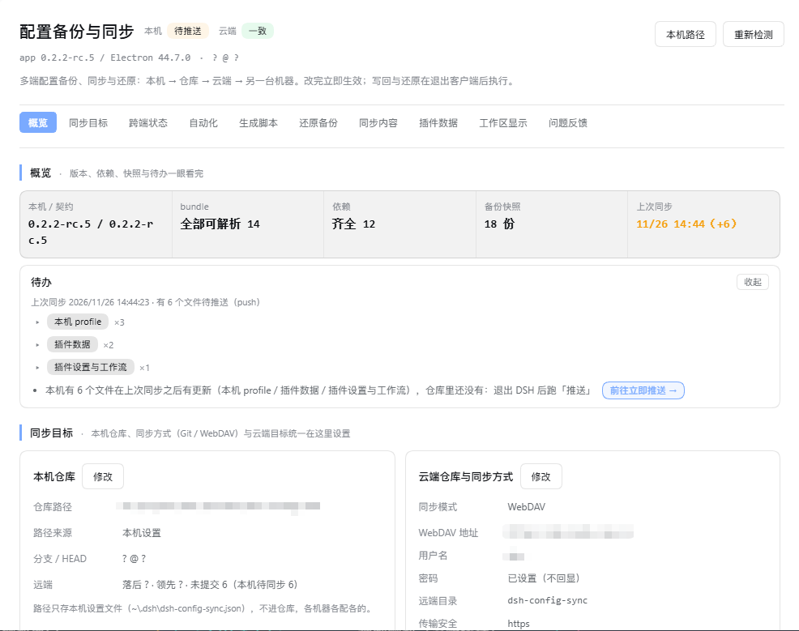

# 配置备份与同步

> **dsh-profile-config-sync** —— DeepSeek Harness 客户端的**多端配置备份 / 同步 / 还原**插件。

[](https://www.npmjs.com/package/dsh-profile-config-sync)
[](https://github.com/huanyu-a/dsh-profile-config-sync/releases/latest)
[](LICENSE)
[](#同步内容勾选)
[](#同步内容勾选)
[](#自检)

中文 | [English](README.en.md)

DSH 的配置散在 `~/.dsh` 的十几处：profile、全局提示、Skills、Agent 预设、插件设置、插件数据、工作区、会话记录。
这个插件把它们按 **12 组内容**抓成一份 Git 仓库快照，推到你自己的 Git 远端或 WebDAV 云端；换机器、重装、误改，一条命令拉回来铺好。
**同步动作在客户端退出后执行**，不会搬走写了一半的配置。

来源：基于 [QcWyGm/dsh-config-sync-plugin](https://github.com/QcWyGm/dsh-config-sync-plugin)（MIT）重写与扩展，见文末[「来源与版权」](#credits)。



---

<a id="features"></a>

## 主要功能

- **12 组内容抓取**：profile、全局提示词、Skills、Agent 预设、技能市场台账、插件设置与工作流（14 个源）、记忆数据、本地源码插件、插件数据槽、额外路径、工作区、会话记录（含附件与 `session_projcache`）。逐组 / 逐项可关，抓不到的会在窗口末尾与面板常驻提示里点名。
- **两种传输**：Git 远端（SSH / HTTPS，GitHub / Gitee / GitLab / 自建 Gitea、Forgejo）与 **WebDAV**，共用同一份仓库格式，随时可换。
- **四个动作 + 一键脚本**：推送、拉取、还原（回滚到某个快照或 git 提交）、初始化推送（空仓库起步），各生成可双击的 `.cmd`（Windows）/ `.sh`（macOS、Linux）。
- **退出后执行**：不在客户端运行中搬文件；可排队到下次启动；自动同步能自己把客户端拉起来。
- **跨端不分叉**：Windows 走 PowerShell，macOS / Linux 走 Node 引擎，共用一份仓库，机器身份记在 `machines/`。
- **覆盖前留底**：将被覆盖或删除的本机文件先备份到 `~/.dsh/backups/`，选错档也能再回滚一层。
- **面板体检**：本机 / 云端双徽标（云端每 2 分钟复查）、版本契约、bundle、依赖、备份快照、上次同步、待办跳转。
- **安全边界**：浏览器剖面与凭据库在抓取、上传、引擎三处独立硬拦；单文件上限三档（>100 MB 抓取即跳过、≥95 MB 提交前剔除、50–95 MB 只警告）；冲突两侧留副本；路径遍历防护。
- **待推送口径跟执行体一致**：Windows 按 12 组统计，macOS / Linux 只统计引擎真会同步的 4 组，不虚报。
- **自更新**：只查 npm registry（不看 GitHub），面板内检查、下载、安装。

**四个关键词**：**配置**（12 组按需抓取）· **备份**（仓库即快照，Git 有历史）· **同步**（一台推、一台拉）· **还原**（铺回本机，可回滚）。

一句话流程：**本机 → 抓取 → 仓库 → 推送 → Git 远端 / WebDAV → 拉取 → 另一台机器**，每一步都能退回上一档。

---

## 目录

| [安装](#install) | [从零开始](#quickstart) | [面板](#panel) | [同步内容](#groups) |
|---|---|---|---|
| [脚本](#scripts) | [还原备份](#restore) | [插件数据](#plugindata) | [自动同步](#automation) |
| [仓库 / 云端](#repos) | [WebDAV](#webdav) | [问题反馈](#feedback) | [工作区与会话](#crossplatform) | [接口](#api) | [来源与版权](#credits) |

[历史版本细节](docs/HISTORY.md) · [完整实测记录](docs/CHANGELOG.md) · [字段与接口参考](docs/REFERENCE.md)

---

<a id="install"></a>

## 安装

插件包名 **`dsh-profile-config-sync`**（npm 上的 `dsh-config-sync` 是**上游同名项目**，不是这个包）。

| 方式 | 命令 / 入口 |
|---|---|
| npm | `npm i dsh-profile-config-sync`（**已发布到与 GitHub Release 相同的版本**，`latest` 标签指的就是它） |
| 插件市场 | 客户端「插件市场 → 发现」搜「配置备份与同步」（`market-index.json` 登记的 `source.type` 是 `npm`，装的就是 registry 上的在线版） |
| 离线 tgz | `pnpm add ./dsh-profile-config-sync-0.6.49.tgz`（内网机器用这个） |

**发布状态**：最新 Release 是 [`v0.6.48`](https://github.com/huanyu-a/dsh-profile-config-sync/releases/tag/v0.6.48)（2026-11-28）；0.6.49（macOS 修复）在本地分支验证中，尚未发布，仓库已公开；npm 上的同名包同步发布（`npm i dsh-profile-config-sync`）。

要正式发布时（需要有权限的账号，我不会擅自 push）：

```bash
gh release create v<版本> dsh-profile-config-sync-<版本>.tgz \
  --repo huanyu-a/dsh-profile-config-sync --title "v<版本>" --notes-file <发布说明.md>
# tag 与包名必须是同一个版本号，别像旧文档那样写成 v0.6.39 配 0.6.44 的包
git tag -a v<版本> -m "v<版本>" && git push origin v<版本>
# 发布后把仓库根的 version.json 更新到新版本并推上去：它随 npm 包一起发布（files 里有它），面板读的是包内那份
# （version.json 不在 npm 包里，files 字段没有它）
```

装好后插件目录是 `<客户端根>\dsh-profile-config-sync-<ver>`，`appRoot` 留空时由插件位置反推客户端根。

## 面板路由的准入

13 条 `/config-sync/*` 路由在进入处理器之前，先由宿主 Connection 判定：
`ctx.connection.requestRejection(request)` —— DSH 官方的 Host/Origin 围栏加浏览器会话鉴权，
和 GUI 自己的 `/api` 通道是同一套。宿主没有 `connection` 服务时（非 Web 载体），才退回插件自己的
`originAllowed`（只认本机 Host、拒绝跨站与 `Sec-Fetch-Site: cross-site`）。

**为什么要有这一层**：`webServer.register` 只是裸 HTTP 载体，DSH 文档写得很直白——
「The carrier owns no authentication or Origin policy」，路由鉴权是组合层的责任。
0.6.41 及之前只靠插件自己写的 `originAllowed`：缺 `Origin` 头的请求（本机任意进程、`curl`）
会被当成可信来源放行，实测裸 `curl http://127.0.0.1:<端口>/config-sync/status` 返回 **200**（宿主端口每次启动会变，取 `DSH_WEB_URL`），
能读到仓库路径、配置摘要、待同步清单，也能触发推送与还原。
现在同一请求得到 **401**，拒绝响应体只有 `{ ok: false, error: "unauthorized" | "forbidden" }`，不含任何业务字段。

因为依赖 `requestRejection` / `connection.fetch` 这组准入接口，`package.json` 声明了 `engines.dsh: ">=0.2.2-rc.5"`。
这个下限是量出来的，不是拍的：准入接口在 0.2.2-rc.5 的源码里已经在（`dsh-client-connection/src/rpc-host.ts` 的 `requestRejection` / `admit`），
而 DSH 在安装与 profile 启动时都强制检查 `engines.dsh`（拿一个声明 `>=99.0.0` 的假插件在临时 profile 上就能复现 `incompatible-version` 拒绝），
所以写 `>=0.2.3` 会把正跑着 0.2.2-rc.5 的机器直接挡在门外。等运行时升到 0.2.3+ 之后，这个下限可以一行收紧。

自检里有专门的一套（`route-admission`，16 条断言）：13 条路由在 403 / 401 / 放行 / 无 connection 四种情形下逐一验证，
并做结构断言「每条 `webServer.register` 的 handler 都套了准入」，防止以后新增路由时漏掉这一层。
## 已知限制

- **非 Windows 没有互斥**：Windows 的 capture / apply 走 `Lock-SyncRun`（命名 Mutex），同一 `~/.dsh` 并发时后来者以退出码 3 结束；macOS / Linux 的引擎没有这层锁，两个动作同时跑仍可能撞文件。
- **非 Windows 引擎只覆盖 4 组**：profile / 全局提示 / Skills / 预设；会话记录、插件数据、额外路径要 Windows 版。
- **浏览器剖面永不入库**：`browser-profiles` / `Login Data` / `Cookies` 等路径段三处硬拦（见[插件数据](#plugindata)）。

---

<a id="quickstart"></a>

## 从零开始：让第二台机器跑起来

源机器推一次、目标机器拉一次（隔离环境两台假机 + 本地裸库实测走通）：

```
源机器 A ──────────────────────► 远端（Gitee / GitHub / 自建） ──────► 目标机器 B
1 装插件（tgz 或市场）                                              1 装「同版本」客户端并启动一次
2 面板填 本机仓库 + 云端地址                                        2 装插件，填同一对本机仓库 + 云端地址
3 点「初始化推送」                                                 3 点「拉取」（会用仓库版本覆盖本机配置）
```

**前置条件**（缺一项就卡住）：

| 项 | 要求 | 不满足时 |
|---|---|---|
| 客户端版本 | 两台**同版本**（`profile\host-contract.json` 校验） | 拉取报 `版本不一致`，加 `-AllowVersionDrift` 才能强铺 |
| 目标机器 `.dsh` | 至少启动过一次客户端 | `[X] 目标 profile 不存在`，拉取直接退出 |
| 内置运行时 | `<AppRoot>\node.exe` 或客户端本体 | `本机没有可用的内置运行时` → 会话 cwd 改不了，**会话列表是空的** |
| git | 两端都装 | `找不到 git.exe` |

命令行等价（面板点按钮就行，这里是同一件事）：

```powershell
pwsh -File runtime\sync.ps1 push   -RepoRoot <仓库目录> -DshHome <~\.dsh> -AppRoot <客户端根> -SkipInstall -Force
pwsh -File runtime\sync.ps1 pull   -RepoRoot <仓库目录> -DshHome <~\.dsh> -AppRoot <客户端根> -SkipInstall -Force
```

`-SkipInstall` 跳过 `pnpm install`（离线场景必须）；`-Force` 跳过「检测到 DSH 在运行」的保护（真机请先退出客户端，别用）。

> 从零验证最容易踩的 5 个点、首次推送/拉取的原始输出，见 [docs/REFERENCE.md](docs/REFERENCE.md#fromscratch)。

## 入口挂在哪

| 入口 | slot | 说明 |
|---|---|---|
| 左侧栏一行 | `sidebar.panellist`（`id: config-sync`） | 标题「**配置备份与同步**」（英文 Config Backup & Sync） |
| 点开的面板 | `main`（`key: config-sync`） | 与侧栏行必须在**嵌套 inject** 里成对 register（细节见 [REFERENCE](docs/REFERENCE.md#slots)） |
| 设置摘要行 | `settings.general.item` | 「设置 → 通用」里同名摘要行：一行四态 chip + 展开（仓库、远端、私钥） |

包里有什么（`index.js` / `client.js` / `runtime/` / `tools/` 等）见 [REFERENCE](docs/REFERENCE.md#files)。

<a id="panel"></a>

## 面板显示什么

- **标题行**：`配置备份与同步　本机 [一致/待推送/待拉取/有问题]　云端 [一致/不一致/待拉取]`。云端全自动（挂载查一次、之后每 2 分钟复查）。
- **元信息行**：`app 版本 / Electron 版本 · 分支 @ 短 HEAD`。
- **指标条**：`本机 / 契约`、`bundle`、`依赖`、`备份快照`、`上次同步`（`(+N)` = 之后又写入几个文件）；有事才出现「待办」。
- **分区**：概览 → 本机路径（默认整块不显示，点标题行按钮展开，有告警时变橙带数字）→ 同步冲突（真有冲突才出现）→ 同步目标 → 自动化与插件更新 → 退出后执行 → 还原备份 → 同步内容 → 问题反馈。
- **「待推送」不只看 git**：`git status` 干净时新会话可能还没 capture。`status` 按 mtime 比对 capture 真正会抓的 12 组，晚于上次同步的计入；取消勾选的组不计入。上限 20000 文件 / 1.5 秒，便宜的配置类先扫、贵的后扫。
- **「待拉取」= 本机仓库还是空目录**（不报异常，橙色徽标）。上次自动同步的结果若在 15 分钟内，启动时会弹一条 5 秒浮层，同一份结果只弹一次。
- **统一交互**：所有卡片先只读，点「修改」才解锁，改完「保存」生效。没配过的卡强制停在编辑态。

<a id="repos"></a>

## 本机仓库 / 云端仓库

- **仓库判据**：目录里同时有 `apply.ps1` 与 `profile\package.json`（再有 `sync.ps1` 才算能推拉）。
- **优先级**：本机设置文件 → 插件配置 `repoPath` → `DSH_CONFIG_REPO` → 常见位置探测；配置里填的空目录同样算有效答案。
- **四态** `repo.phase`：`ok` 真仓库、`empty` 空目录待首次拉取、`missing` 目录不存在、`unusable` 有别的文件却不像仓库；`pushAllowed` / `pullAllowed` 按它算。
- **空目录 + 云端有内容 → 只允许拉取**：推送置灰，`prepare(push)` 与 `auto(push-now)` 一律 400。拉取走 `git init` → 补 `origin` → `fetch` → `checkout -B <分支>`（不用 clone，目录里可能已有 `同步-*.cmd`）。
- **两边都空 → 只允许初始化推送**：写骨架 + capture + 提交 + `push -u origin main`。
- **云端有没有东西**用 `git ls-remote --heads` + 临时 bare `fetch --depth 1 --filter=blob:none` + `ls-tree -r` 数文件数（15 秒超时）；探不到（离线/认证失败）就只允许拉取，`remoteFiles===0` 一律算两边都空，用 `--force-with-lease` 覆盖那个空分支。
- **没配过 = 强制设置**：卡片停在编辑态、不给「取消」，`prepare` 也 400（远端缺失时「还原」不受影响）。
- 设置落在 `~\.dsh\dsh-config-sync.json`，跟本机走、不进仓库；SSH 私钥只存**路径**，可留空交给 `.ssh\config`。

## 支持的云端平台

不挑平台：远端只校验写法，`fetch` / `push` / `pull` / `ls-remote` 全交给 git。Gitee、GitHub、GitLab、自建 Gitea/Forgejo 走同一条路。

| 项 | 说明 |
|---|---|
| 地址写法 | `git@host:owner/repo.git`、`ssh://git@host:port/owner/repo.git`、`https://host/owner/repo.git` |
| 默认分支 | 先试 `main`，没有就取远端第一个分支（老仓库 `master` 也行） |
| 认证 | SSH 填私钥路径；HTTPS 用 Git 凭据管理器，插件不存密码 |
| 单文件上限 | 三档：源头 >100 MB 抓取时跳过、≥95 MB 提交前剔除、50–95 MB 只警告 |

私有库：优先 SSH 地址。插件**自身更新**只查 npm，与本机配置的 Git 远端无关，所以换成私有库也不影响自更新（也不用再为它配令牌）。

<a id="webdav"></a>

## WebDAV：第三方服务连不上时

WebDAV 与 git 共用同一份仓库格式，只换传输层（不依赖 git、不需要远端仓库）。面板「云端仓库与同步方式」卡里填地址、账号、密码与远端目录即可。

| 项 | 说明 |
|---|---|
| **User-Agent** | 可填客户端名（如 `Mozilla/5.0`、`davfs2/1.6.1`）。部分第三方 DAV（群晖 / 坚果云 / 自建）按 UA 放行或拦截，报 403 时填它要求的那个。**留空 = 完全不发 User-Agent 头** |
| 允许的 UA 字符 | 单行可见 ASCII，不含换行 / 中文 / 制表符，不超过 200 字符；填了非法值会明确报错，不会静默存成空 |
| 地址 | 填到根（如 `https://dav.example.com/dav`），子目录单独填在「远端目录」 |
| 认证 | Basic（账号 + 密码）。密码只存本机 `dsh-config-sync.json`，面板只显示「已设置 / 未设置」，永不明文回显 |
| 传输安全 | 默认拒绝 http（明文传密码）；确需使用请设 `DSH_SYNC_ALLOW_INSECURE=1` |

**连不上时看具体原因**（0.6.48 起按状态码分开说，不再一律显示「连不上或认证失败」）：

| 现象 | 含义 |
|---|---|
| 认证失败（401） | 用户名或密码不对，或这个服务要求应用专用密码 / Token |
| 被拒绝（403） | 账号没有这个目录的权限；也可能被 User-Agent 拦截 → 填上它要求的客户端名 |
| 404 | 地址下没有这个目录 → 确认地址填到根、目录填在「远端目录」 |
| 不支持 PROPFIND（405 / 501） | 这可能不是标准 WebDAV 入口，或需要带路径前缀 |
| 连不上 / 超时 | 检查地址、网络与证书（自签名证书需加入系统信任库） |

「测试连接」会同时报出**实际发出去的 User-Agent**，方便确认是服务端按客户端过滤还是别的原因。

## 有文件没同步上时

三处会同时告诉你，不用翻日志：

| 位置 | 形式 |
|---|---|
| 进度窗口末尾 | 分类计数 + 最多 30 条明细 + 日志路径 |
| 面板常驻黄框 | 同上，附「下次同步自动复查」 |
| 推送前两道预检 | ①单文件超限 ②历史里有 ≥95 MB 的大文件（会提前说「远端会拒收整次推送」，并给两条路） |

push 失败时会**按真实远端地址归因**：https 走 `ls-remote` 检查（不是 `ssh -T`），主机名取自 `origin`，不是硬编码。

<a id="crossplatform"></a>

## 工作区与会话跟着机器走

跨机可用取决于三处路径是否换成本机值：

| 位置 | 存的是 | 换机器后 |
|---|---|---|
| `workspace\workspace-registry.json` | 每个工作区落点（已写成 `{{APP_ROOT}}/xxx`） | 拉取时展开成本机路径 |
| `conversations\sessions\...\session.v4.jsonl.zstd` | 会话日志首帧的 `cwd` | 重写首帧，其余帧一字节不动（靠 Node 解 zstd；找不到执行器时**宁可不铺**） |
| `conversations\session_projcache\<id>.json` | `record.identity.cwd` | 按登记表 `sessionIds` 反查本机位置再改写；漏这步的症状是「工作区能列出来、点开历史会话指着对方机器的目录」 |

- 推断规则：按登记表的标题/槽位/相对结构在本机展开，**不靠猜盘符**；推断不出来就不改，留给面板提示。
- 推送侧报告分两组：`scope: config`（配置文件里的路径）与 `scope: data`（`workspace\`、`conversations\` 里还指着对方的记录），面板分两列、都能逐条采纳。
- 面板里「隐藏 / 归档」的工作区与会话，状态记在 `dsh-session-manager/workspace-archives.v1.json` 并跟着同步，不会被另一台机器重新显示。
- **同步后新建**的会话落在默认工作区（DSH 自己的规则，插件不动它）。
- **边界**：默认工作区（`default-workspace`）不同步（目录名按各机 `WorkspaceHome` 编码）；`models/`、`*.whl`、`*.safetensors` 与任何 >100 MB 的文件不进仓库。

> 0.3.75–0.3.93 的演进（工作区显示卡片、跳转、折叠、页头布局）见 [docs/HISTORY.md](docs/HISTORY.md)。

<a id="scripts"></a>

## 一键生成的三份脚本

| 文件 | 做什么 |
|---|---|
| `同步-推送.cmd` | 退出后 capture 并推送；先查客户端是否还在跑，本机仓库是空目录时拒绝 |
| `同步-拉取.cmd` | 退出后拉取并 apply；先写明「本机领先几个提交 / 几项未提交」，输 `y` 才动手 |
| `同步-还原.cmd` / `同步-还原-<快照名>.cmd` | 退出后把 profile 退回某次快照；先 `-DryRun` 打计划，按 `y` 才真写 |

三份都写死本机参数（仓库、AppRoot、`.dsh`），双击即可；拉取与还原支持 `--yes` 免确认（远控用），没确认时明说「已退出：本机什么都没改」。提交说明可用 `-Message "..."`，时间由脚本执行那刻自动追加。

## 同步冲突

拉取被本机文件挡住（同路径两边内容不同）时 git 会整批 `Aborting`。**不 reset**：

1. `sync.ps1 pull` 先 `git fetch` 判快进，再算交集（`git diff --name-only HEAD origin/x` ∩ 本机未入库/已修改）。命中就**逐文件两边都备份**、写 `~\.dsh\sync-conflicts.json`，`exit 6` 停下——仓库与配置都不动，HEAD 不回滚。备份在 `backups\conflict-<时间>-拉取冲突-Pull-conflict\`：`本机-Local\`、`云端-Cloud\`、`说明-README.txt`、`清单-Conflicts.json`；任一侧字节数对不上就标未备份、按钮置灰。
2. 重启客户端后面板出现「同步冲突」卡：一行一个文件，点行展开两侧预览，每行「用本机 / 用云端」，底部「全部用本机 / 全部用云端」，还能单独「还原本机副本 / 还原云端副本」（不动 git 历史）。
3. 选完点「立即拉取」：`用云端` 的删掉工作区副本、`用本机` 的也先删（让 git 快进），快进后再把 `用本机` 的从备份写回，变成一次本地改动，下次推送带上。

粒度只有「逐项 用本机 / 用云端」+「单项从备份还原」，不做预览内编辑或手工合并。

<a id="restore"></a>

## 还原备份

面板「还原备份」卡：上面是备份目录（默认 `~\.dsh\backups`，每次 apply 前都会打快照），下面列出快照——名称、时间、插件数、能否还原。

- **列表不显示体积**：整份 profile 几千文件，旧版逐个 `stat`（92 份 / 4.8 万文件实测 7.7 秒）会把 `/status` 拖到 11 秒。现在只给名称/时间/插件数，远端探测改「缓存 5 分钟 + 最多等 2.5 秒」，status 8.0 秒 → 0.35 秒。
- **「立即还原」是个流程**：点行 → 取差异预览（撤走哪些插件、覆盖哪些文件）→ 确认 → 客户端正常退出 → `post-exit.ps1` 弹可见进度窗口跑 `restore.ps1` → 结果写 `auto-sync-result.json` → 自动重启。不用自己退客户端、双击 `.cmd`、输 `y`。
- **时点还原**：快照之后新增的文件移进 `backups\manual-<时间>\rollback\files`；之后装上的插件 junction 只删链接（不穿进链接删实体），实体移进 `rollback\plugins`；清单写 `rollback-manifest.json`，全部可再还原。动手前先把当前配置另存一份。
- **三类备份各有入口**：配置快照（`config-*` / `manual-*`）→「立即还原」；插件备份（`plugin-<版本>-*`）→「回滚插件」；会话备份（`session-corrupt-*`）→「还原会话」。认不出类型的给「手动还原」，弹路径与常见目标位置，不再有死按钮。
- 分类判据按 `name: dsh-profile-*` / `dsh.profile` / `name: dsh-config-sync` 依次判，**不能只看有没有 `package.json`**（profile 里也有 `dsh` 字段，会误判）。空目录标「空备份」置灰。
- 只在这个目录里选：越界、相对路径、含引号换行直接报错。

## 插件配置跟得走

新机器同步完发现「配置没了」，多数不是拉取失败，而是这些配置**从来没进过仓库**。插件配置组覆盖 13 项：

| 仓库路径 | 本机来源 |
|---|---|
| `settings\dsh-workspaces.json` | `~\storages\workspace.json`（新机器「工作区不见了」就是它没同步） |
| `settings\our-free-model.json` / `-picks.json` | `~\our-free-model\settings.json` / `picks.json` |
| `settings\dsh-pet-main-config.jsonc` / `-memory.json` | `~\dsh-pet\main-config.jsonc` / `memory.json` |
| `settings\comfyui-workflows.json` | `~\data\dsh-comfyui\workflows.json` |
| `settings\dsh-qq-config.json` / `-workspaces.json` | `~\integrations\dsh-qq\config.json` / `workspaces.json` |
| `settings\dsh-im-interface-language.json` | `~\integrations\dsh-im\interface-language.json` |
| `settings\dsh-market-state.json` | profile 下 `.dsh-market\state.json` |
| `settings\redteam-preset-declare.json` | `~\redteam\preset-declare.json` |
| `settings\task-board-*.json` | `~\task-board\ledger-v2.json` / `scheduler-v2.json` |

**是白名单，不是整份搬**：`~\.dsh\settings.json` 本身不进仓库，自由格式自定义键会被丢弃。排除凭据与运行时状态（`channel-pack`、`workbuddy-vault`、`dsh-purge`、`stats`/`feed`/`catalog`/`availability`、QQ bot 的 `state.json`、会话缓存）。

**带本机路径的配置**用占位符归一：`{{APP_ROOT}}`、`{{DSH_HOME}}`、`{{WORKSPACE_HOME}}`、`{{ROOT:<key>}}`。capture 写库前归一、apply 落地前展开，仓库里一律正斜杠。某机器缺某个根时**跳过不写**、记进 `config-sync-pending-paths.json`，面板「本机路径」卡让你填一次，之后不再问——宁可跳过也不把 `{{ROOT:xxx}}` 字面量写进配置。

**两条体检**：①推送后扫配置类文件里不属于任何已确认根的绝对路径，写 `config-sync-absolute-paths.json`（**不拦提交**，且只对接收方显示、带推荐目录、可一键采纳）；②拉取覆盖前比一次本机改动，记进 `config-sync-overwrite.json` 提示「有 N 份配置被仓库版本覆盖（本机改动已先备份）」——想保住改动就**先推送再拉取**。

> 两类体检的明细、清单格式与误报过滤见 [docs/REFERENCE.md](docs/REFERENCE.md#checks)。

<a id="groups"></a>

## 同步内容勾选

面板最下面「同步内容」卡：**12 组逐组列出、默认全勾**，点一行展开明细，组和单项都能取消——取消后**推送不再抓、拉取不再还原**（推拉共用同一份勾选）。

| 组 | 云端目录 | 明细 |
|---|---|---|
| 本机 profile | `profile/` | package.json / lock / cordis（整组开关，**必需不可取消**） |
| 提示词 | `prompt/` | `AGENTS.md`、`prompt-inject.md` |
| 技能 | `skills/` | 每个技能目录 |
| 预设 | `presets/` | 每个预设 |
| 技能市场台账 | `storages-record/` | 两个台账 json |
| 插件配置 | `settings/` | 13 个文件（见上节），可单独排除 |
| 记忆 | `mnemon/` | 整目录 |
| 本地插件 | `local-plugins/` | 每个 link 插件 |
| 插件数据 | `plugin-data/` | 每个插件的自己一级目录（自动枚举） |
| 额外路径 | `extra/` | 你自己加的绝对路径 |
| 工作区 | `workspace/` | 每个登记的工作区 |
| 会话 | `conversations/` | 每个工作区对应的会话（含附件与 projcache） |

- 先只读，点「修改」才解锁勾选，改完「保存」才写文件；勾选记在 `~\.dsh\config-sync-scope.json`，本机私有、只留与默认不同的项。
- 跳过**两侧都生效**：`capture.ps1` 不抓、`apply.ps1` 不还原；`-PruneSkills` 也不会把勾掉的本机技能当多余项删掉。
- 另有开关「取消勾选时顺手删掉云端副本」，**默认关**；打开后取消勾选会真的删仓库对应目录（不可恢复）。
- `本机 profile` 是必需内容：仓库里没有 `profile\package.json` 或 `cordis.patch.yml` 时拉取 `[X] 仓库内容不完整` 退出。

<br>

<a id="plugindata"></a>

## 插件数据与额外路径

第三方插件的配置和数据多半写在自己的一级目录（`~\.dsh\<插件名>\`）。这两组把它们也带上：

- **插件数据（`plugin-data/`）**：自动枚举 `<DshHome>` 一级目录，一个目录一个槽 → `plugin-data\<槽名>\...` + `plugin-data\manifest.json`；每槽最多扫 8 层 / 4000 个文件。
- **额外路径（`extra/`）**：面板里加的绝对路径，目录或单文件都行 → `extra\<id>\...` + `extra\manifest.json`。
- **文本归一、二进制保真**：文本里的占位符写库前归一（顺带 CRLF→LF），apply 时展开；`.db` / `.node` / `.exe` / 图片或含 NUL 的文件原样字节拷贝。
- **写回先留底**：apply 逐文件合并，被覆盖的旧文件先备份到 `backups\config-<时间>\plugin-data-<槽>` 或 `extra-<id>`。

### 规则文件：`~\.dsh\config-sync-extra.json`（本机，不进仓库）

面板「插件数据与额外路径」卡直接改这份文件：`pluginData.enabled`（整组开关，与「同步内容」联动）、`pluginData.maxFileBytes`（**硬顶 100 MB**）、`pluginData.exclude`（排除名单，通配，**整份替换**）、`pluginData.skipDirs`（自动枚举跳过的目录名，整份替换）、`extra.enabled` / `extra.paths[]`（`{id,src,label}`，src 必须绝对路径）。字段级说明见 [REFERENCE](docs/REFERENCE.md#extra)。

**自动枚举默认跳过 17 项**：`profiles`、`skills`、`.agent-presets`、`storages`、`sessions`、`attachments`、`logs`、`backups`、`update-staging`、`electron`、`dsh-runtimes`、`dsh-market`、`.dsh-plugin-market`、`dsh-session-manager`、`browser-profiles`、`im`、`node_modules`（外加所有隐藏目录）——要么已有专门的组，要么是缓存/运行时。

默认排除名单（**62 条**，可按需删改）：`*.db` / `*.db-*` / `*.sqlite*`、`*.node` / `*.exe` / `*.dll` / `*.asar` / `*.pak` / `*.bin` / `*.img` / `*.iso`、压缩包 `*.zip|7z|rar|tar|gz|tgz`、`*.mp4|mkv|avi`、`*.log` / `*.tmp` / `*.bak` / `*.old` / `*.orig` / `*.swp`、`api-key` / `*.pem|key|p12|pfx|crt`、`*cache*` / `*token*` / `*secret*` / `*credential*` / `*password*`、`*vault*`、`node_modules` / `.git` / `.cache` / `__pycache__` / `.venv`，以及 0.6.12 起为防剖面泄漏加的 `browser-profiles` / `User Data` / `Login Data` / `Cookies` / `Web Data` / `Local State`。

> 排除名单**整份替换**：清空就真的不排除任何文件。`check` 时代码会按内置名单补齐这 6 条安全必需项，缺了会在卡上提示。

**`restore.ps1 -FromCommit <sha>`** 只还原提交里的 `profile\`（决定客户端能不能起来的几个文件），`prompt\`、`skills\`、`settings\` **不在范围**；要全量请用 `sync.ps1 pull`。边界是有意留的：崩溃场景只求能进主界面。

### 浏览器剖面 / 凭据库：不进仓库、不上传

旧版把 `~\.dsh\browser-profiles`（给 CDP 用的 Edge/Chrome 用户目录）当普通插件槽抓进了仓库——本机实测 **3,696 个文件 / 297.7 MB**，含 `Login Data`（密码库）、`Cookies`（登录态）、`Web Data`（自动填充）、`Secure Preferences`、`History`；而当时的上传门禁只认「文件名白名单 / `.env` / `*.pem` / `ghp_` 令牌」，一个都不匹配。

现在三层同源拦截：

| 层 | 行为 |
|---|---|
| 抓取（PowerShell） | 命中即拒收不落盘；每次 capture 还会删掉仓库里历史遗留的这批文件并报条数 |
| 上传/下载门禁（WebDAV） | 按**路径段**判定，深层嵌套也拦；另加单文件 32 MB 上限 |
| 引擎（macOS/Linux） | 同一份段名名单 |

被拦的路径段：`browser-profiles`、`User Data`、`Login Data`、`Login Data For Account`、`Cookies`、`Web Data`、`Secure Preferences`、`Local State`、`History`、`Top Sites`、`Current Session`、`Current Tabs`。规则只看路径不看体积，所以「插件把剖面放得更深」也拦得住。

<a id="feedback"></a>

## 问题反馈（带截图与录屏）

面板最后一区的「问题反馈」：写标题与详情 → **提交即建 GitHub Issue**（label `feedback`），另一台机器打开面板看到的是同一份列表；点「已解决」就关单。

**附件（0.6.48 起）**：截图与录屏是「界面显示不对」「同步报错」这类反馈里最关键的证据，以前只能靠打字描述。现在可以直接选文件：

| 项 | 说明 |
|---|---|
| 支持的类型 | 图片（png / jpg / jpeg / gif / webp / bmp / svg）、视频（mp4 / mov / webm）、文本（log / txt / md / json） |
| 数量与体积 | 最多 4 个，单个 ≤ 20 MB |
| 存放位置 | 传成**反馈仓库自己的 release assets**（GitHub 的 asset 接口只有 release 有，Issue 没有），正文引用它 —— 不借道第三方图床，换机器、别人看都能打开，也不依赖你本机的文件还在。附件挂在一个**草稿 release**（tag `feedback-assets`）上，不会出现在 Releases 页面 |
| 正文引用 | 图片用 Markdown 图片语法（直接显示），视频与日志用普通链接（点开下载 / 播放） |
| 需要令牌 | 上传资产要 GitHub 令牌。没有令牌时走「浏览器预填页面」，面板会**明确告诉你附件没上传**，请手动拖进网页 —— 不会静默丢弃 |
| 网络不通 | 已上传的附件 URL 会存进本机待发队列，点「补发」时直接引用，不重复上传 |

被拒的附件（类型不对、超大、损坏）会逐条报出来，不会假装「都带上去了」。

<a id="automation"></a>

## 自动同步（默认关）

| 开关 | 行为 |
|---|---|
| 启动时自动拉取 | 启动 8 秒后只读 `git fetch` 比对；落后 > 0 → 确认框 → 选「是」当场整族退出客户端 → 可见窗口跑拉取 → 自动重启 |
| 退出时自动推送 | 本地领先提交 / 未提交改动 / 本机资料比上次同步新，**任一命中就排队**；启动后每 2 分钟复查，点 × 关闭时也立即判一次 |

- 由 `runtime\post-exit.ps1 -Phase wait`（隐藏）盯退出，真退了才起可见窗口跑同步；**排队期间不弹窗**。
- 一个时刻只跑一次：`~\.dsh\auto-sync.lock` 记 pid，后来者复用或先结束没开工的等待进程。
- 等退出按**进程名**判（插件跑在子进程里）：活过 60 秒且无可见窗口 16 秒 → 结束残留进程再同步。
- **拉取失败自动回滚**：`git reset --hard` 回原提交 → 用这次写盘前刚建的 `backups\config-<时间>` 跑 `restore.ps1`。
- 退出码：`0` 完成、`2` 等待超时、`3` 缺 sync.ps1、`4` 重启失败、`5` 同步失败（pull 已尝试回滚）。

## 插件自更新

面板「插件更新」卡：**只查 npm registry，不看 GitHub**。挂载查一次、之后每 30 分钟复查。

| 状态 | 含义 |
|---|---|
| 绿色「已是最新」 | 本地版本 ≥ npm 上的 `latest` |
| 橙色「有新版本」 | npm 上更大，附说明与「下载更新」 |
| 橙色「已下载，待安装」 | 包在 `~\.dsh\update-staging\`，插件目录一字节没改，点「重启并安装」生效 |
| 橙色「已安装，待重启」 | 运行中装过但没重启 |
| 红色「检查失败」 | npm 读不到，附「检查更新」列出失败原因 |

- **只查 npm**：版本取 `dist-tags.latest`（几十字节），下载地址与校验值取该版本单版本文档的 `dist.tarball` / `dist.integrity` / `dist.shasum`，发布说明取包内 `version.json`。GitHub 的 raw / API / gh-proxy / ghfast 四条清单源已整体退休。
- **校验值与被校验物同源**：npm 上的 tarball 与 GitHub release 资产**不是同一份字节流**（实测 `npm pack` 与 registry 上的 tarball 逐字节一致，但与 `pnpm pack` 的资产不同）。所以校验用 registry 自己给的 `integrity`（sha512 SRI）/ `shasum`（sha1），不用打包时算的 sha256 —— 后者对 npm 下载必然对不上。
- **registry 可换镜像**：设置 `updateRegistry` 或环境变量 `DSH_CONFIG_SYNC_NPM_REGISTRY`。换了也仍然只查 npm（只是换了个 registry）。
- **下载与安装分开**：下载只落 `update-staging` 并校验，宿主不碰插件目录；点安装才退出 → 备份旧目录 → 覆盖 → 自动拉起，全程只重启一次（运行中覆盖会让宿主把面板卸载掉，0.3.4–0.3.6 踩过）。

<a id="api"></a>

## 接口与路径

宿主挂 13 条 `/config-sync/*` 路由（`status`、`prepare`、`settings`、`auto`、`update`、`scope`、`extra-config`、`conflict`、`roots`、`feedback`、`cache-guard`、`workspace-view`、`webdav`），跨站请求 403。完整请求/响应形状、路径解析顺序、本机私有文件清单见 [docs/REFERENCE.md](docs/REFERENCE.md#api)。

**边界**：`capture` 要读 `cordis.patch.yml`，运行时这文件正被应用持有（抓到半截）；`apply` 写完 DSH 退出时又会回写覆盖。所以边界固定为——判断该跑什么、把命令写好，退出 DSH 后执行。

## 自检

`node tools\selftest.mjs`（默认在临时目录造隔离 `DSH_HOME` + 夹具，`--in-place` 才连真实 `~/.dsh`；传仓库路径可额外跑仓库就绪分支）：假 ctx 拉起宿主半身，打 status、生成脚本、断言 JSON 与落地文件。`node tools\webdav-selftest.mjs`：进程内起一个最小 WebDAV 服务器（真 HTTP / 真 XML / 真落盘，只连 `127.0.0.1`），覆盖逐级 MKCOL、按 sha256 判重、冲突留底、空云端、不可达服务器与明文地址闸门——完全离线，CI 可直接跑。`node tools\clientcheck.mjs` 检查浏览器半身。`npm run verify` 依次跑这三个。都只在源码仓库里跑（安装副本不含 `tools/`）。

## 实测记录

| 日期 | 版本 | 要点 |
|---|---|---|
| 2026-11-28 | 0.6.49 | **macOS 全面可用**（本机切到 macOS 后集中修 Windows 假设）：① 客户端根 `isAppRoot` 只认 `<root>/resources`，`.app` bundle 永远认不出 → AppRoot 为空、面板报「定位不到客户端根目录」；改按 `Contents/Resources` 归一。② app / Electron 版本写死 `<root>/resources/app.asar` 与 `<root>/version`；改由 `runtime/platform.mjs` 读（asar 头解析 + Framework 的 Info.plist）。③ 仓库路径只探 `D:/G:/C:`，且 POSIX 上把 `D:\dsh-config` 当相对路径真建目录；改默认 `~/dsh-config` + 按平台校验形状。④ 退出后同步只找 `post-exit.ps1`（macOS 上 spawn powershell 必 ENOENT）；新增 `runtime/post-exit.mjs`。⑤ 自更新只找 `install-plugin.ps1`；新增 `runtime/install-plugin.mjs`（sha256/integrity 校验 + 自己解 tarball + 回滚）。⑥ 新机器 pull 缺 `Initialize-RepoIfNeeded` 等价物 →「拉取成功、什么都没落地」；改先 ls-remote 取默认分支再 checkout 跟踪。⑦ capture 不写执行体 → 首次推送后仓库被判「不像仓库」；改与 Windows 版一样把引擎模块写进仓库根。⑧ POSIX 还原脚本裸调 restore；改与 .cmd 对齐（快照信息 → `-DryRun` → 确认 → 真跑，响应带 backup）。⑨ 面板路径占位符 / 执行体名随平台。⑩ 自检改临时隔离 `DSH_HOME`（`--in-place` 才连真机），不再把测试值写进用户配置。⑪ 云端目标卡强制编辑态下 `activeMode` 不跟随下拉框 —— 选 WebDAV 仍显示 Git 字段、保存报「请填写 WebDAV 地址」（用户实测），并停止在 WebDAV 模式下回写 git 设置。⑫ **安全**：私钥名单只有自家文件名，`id_ed25519` / `id_rsa` / `*.ppk` 这类裸名会被原样上传；改按名字 + 内容（PEM / PuTTY 头）双重拦截，上传侧与 capture 共用同一份正则。⑬ 新增 `tools/webdav-selftest.mjs`：进程内最小 WebDAV 服务器，覆盖逐级 MKCOL、sha256 判重、冲突留底、空云端、不可达、明文闸门。⑭ 后台自动拉取（启动 8 秒首检）在 macOS 上也会弹原生框，而那条路径没有请求也没有面板 —— 框被窗口挡住就等于「自动拉取永不发生」；改挂 `status.auto.pullPrompt` + 日志，由面板一键接手，Windows 保持原样。⑮ macOS 上 /var、/tmp 是指向 /private/... 的符号链接，`git rev-parse --show-toplevel` 报真实路径，而引擎按字面量比 —— 仓库放在符号链接目录（/tmp/dsh-config 或链到外置盘）时推送/拉取一进门就报「这个目录不是仓库根」；改成两边 realpath 后再比。⑯ 同步范围卡：非 Windows 只有四组真会同步，范围卡却照样列出十二组可勾 —— 现在按平台带 `supported`，不支持的组禁用并标注「此平台暂不支持」。⑰ 会话记录进 Node 引擎：`--ws-<工作区ID>--` 稳定目录名 + `session-index.json` + 四块数据字节保真；会话日志走 seq 护栏，两台机器同时写同一会话不再互相覆盖出 `seq gap`；默认工作区不参与同步。⑱ 插件数据 / 额外路径也进 Node 引擎：规则（单文件上限 / 排除通配 / 跳过目录 / 安全必需项）收进 `runtime/extra-rules.mjs`，面板与引擎共用一份；顺带修掉「每次 capture 都重写所有文本文件、谎报改动数」。⑲ profile 组补 `cordis.yml`（哪些插件开着）与 `pnpm-workspace.yaml`，入库占位符化、apply 展开成本机路径。⑳「插件设置与工作流」进 Node 引擎（14 个配置文件，清单共用 `runtime/settings-sources.mjs`），易变计数清零；凭据嗅探提到共用模块，名字 + 内容两道门（之前 settings 会把带 apiKey 的配置原样入仓）。㉑ 再补三组：技能市场台账、记忆数据（`<AppRoot>/mnemon`）、本地源码插件（`link:` 目录打包成 `local-plugins/<名字>.zip`，新写的最小 zip 读写只依赖 `node:zlib`；换机解到 `<DshHome>/local-plugins-restore/` 由用户重新 link）。顺带修「源码里出现 apikey 字样就被当凭据」的误判。㉒ 最后一组「工作区资料」进 Node 引擎，但只同步**登记表**（registry-only）：仓库里是 `workspace/workspace-registry.json`（id / 标题 / 槽名 / 占位符路径 / 会话 id / 默认工作区），不搬文件树（本机 5 个工作区里有 1.9 GB 的那个）；还原按 id 合并且本机优先，另存 `workspace-from-cloud.json` 备查。至此 **12 组全部支持**。㉓ 跨平台拉取护栏：另一套系统传上去的 `profile/*` 与 `prompt/AGENTS.md` 只摊到 `profile-from-cloud/`、`prompt-from-cloud/`，不覆盖本机。㉔ 跨平台时 `settings` 组那份整份工作区登记表也不铺（实测会把本机 5 个工作区换成 19 个 `D:\` 路径）。㉕ 跨平台移植 `runtime/porting.mjs`：路径按「映射表 → 环境变量 → WSL → `C:\Users` → 同名工作区」翻译，`package.json` 本机优先合并、`link:` 目标必须真有 `package.json`、`file:` 缺 tgz 就丢，bundles 同步收敛；工作区登记表翻译后按 id 合并；推送后自动删云端的 `browser-profiles`（Login Data / Cookies）。㉘ 平台分区：`profile/<平台>/`、`prompt/<平台>/AGENTS.md`、`settings/<平台>/dsh-workspaces.json`，读时本平台优先、根目录老位置只读不写 —— 一份仓库给 Windows / macOS / Linux 各用各的。㉙ 共享配置互相覆盖：`skills`/`presets` 按云端镜像（删掉本机多出来的，删前留底）；㉚ 全局提示按平台分开（`prompt/<平台>/AGENTS.md`）。验收：`selftest` 464 条 / `webdav-selftest` 25 条 / `webdav-selftest` 24 条 / `clientcheck` 57 条全绿 |
| 2026-11-28 | 0.6.48 | **修 issue #7 / #8（第三方 WebDAV 连不上）与 #9（反馈带不了截图）**：① WebDAV 卡新增 **User-Agent** 输入项（issue #8）——部分第三方 DAV（群晖 / 坚果云 / 自建）按客户端名放行或拦截，没有这一项就只能看到「连不上」。UA 留空 = **完全不发这个头**（实测：Node 的 `fetch` 永远自带 `node` 这个 UA、无法表达「不发」，所以传输层从 `fetch` 换成 `node:http`/`node:https`，并自己处理重定向与 `Content-Length`；Windows 的 PowerShell 与 macOS/Linux 的 Node 引擎都走同一个 `webdav.mjs`，行为一致）。UA 只接受单行可见 ASCII（≤ 200 字符、不含换行 / 中文 / 制表符），非法值保存时直接报错，不静默存成空。② 连不上时**按状态码分开说原因**（issue #7）——原来一律是「连不上或认证失败（PROPFIND 无响应）」，用户既不知道是密码错、还是服务不支持 PROPFIND、也不知道该改哪一项；现在 401 / 403 / 404 / 405 / 重定向 / 超时 / 证书各有一句话，并给出「该改哪一项」；「测试连接」还会报出**实际发出去的 UA**，方便区分「服务端按客户端过滤」与别的原因。③ **问题反馈支持图片 / 视频 / 日志附件**（issue #9）——走 GitHub 的 release asset 接口传成反馈仓库自己的资产，正文引用它（图片内联、视频与日志给链接），不借道第三方图床，换机器与别人看都能打开；asset 接口只有 release 有（Issue 没有），所以附件挂在草稿 release（tag `feedback-assets`）上，不会出现在 Releases 页面；上限 4 个 / 单个 20 MB、类型白名单；不合格的附件逐条报错，**没有令牌时明确告知「附件没上传、请手动拖进网页」而不是静默丢弃**；建 Issue 失败时已上传的附件 URL 存进待发队列，补发时直接引用不重复上传。④ 顺带把 README 里「宿主挂 7 条路由」的陈旧数字改成实际的 13 条。验收：`tools/selftest.mjs` 374 条断言全绿（含 40 条新增：UA 真发出去 / 留空不发 / 四类非法值被拒 / 401·403·405 原因分得开 / 404 仍算「云端是空的」 / WebDAV 上传→跳过→下载整条通路实测 / 附件白名单与正文引用）、`tools/clientcheck.mjs` 全绿；另有 6 条与本次改动无关的既有失败（需要真实远端与真实客户端安装目录的用例）在改动前后完全一致 |
| 2026-11-27 | 0.6.47 | **更新只查 npm + 在线安装**：更新检查整体换成读 npm registry（dist-tags 定版本、单版本文档取 dist.tarball / dist.integrity、说明取包内 version.json），GitHub 的 raw / API / gh-proxy / ghfast 四条清单源与「更新清单 / 更新令牌」两项设置一起退休；市场索引 `source.type` 从 git 改成 npm，装的就是在线版。顺带修两个真 bug：① 旧「清单记 pnpm pack 的 sha256、npm 当兜底下载」在校验那步必然失败（实测 npm pack 与 registry 上的 tarball 逐字节一致，但与 pnpm pack 的资产不同），现在校验值取自 registry 自己；② 市场索引 publishTimestamp 写成毫秒而非 Unix 秒，DSH 的 parseMarketIndex 会拒掉整个索引——插件市场里此前根本读不出这个插件。功能代码改动集中在更新链路，同步/还原逻辑未动。验收：64 套隔离夹具共 1064 条断言全绿（不含检查这份 README 的文档对账套件本身；另有 1 条权限断言在 Windows 上标 SKIP，不会假装通过） |
| 2026-11-27 | 0.6.46 | **徽章数字接回计数**：0.6.41 手工写死的「64 套 · 1065 条」两版没再动，与同页验收声明（1061）打脸；现在 finalize 从 `last-count.json` 直接生成，口径与验收声明一模一样（只算非元套件：64 套 · 1061 条），人手不再参与。功能代码无改动。验收：64 套隔离夹具共 1061 条断言全绿（不含检查这份 README 的文档对账套件本身；另有 1 条权限断言在 Windows 上标 SKIP，不会假装通过） |
| 2026-11-27 | 0.6.45 | **文档对齐现实**：① 中英 README 去掉「npm 上只到 0.4.1」的陈旧说法（改为「与 GitHub Release 同版本」，`dist-tags.latest` 即它）；② 发布命令块改成同版本占位，修掉「v0.6.39 配 0.6.44 的包」的自相矛盾；③ 写清 `version.json` 不在 npm 包里、面板更新检查读的是仓库里那份。功能代码无改动。验收：64 套隔离夹具共 1061 条断言全绿（不含检查这份 README 的文档对账套件本身；另有 1 条权限断言在 Windows 上标 SKIP，不会假装通过） |
| 2026-11-27 | 0.6.44 | **一致性**：历史字段 `dsh.engines.dsh` 对齐顶层 `>=0.2.2-rc.5`；README 中英去掉写死的 10297，改 `127.0.0.1:<端口>`（以 `DSH_WEB_URL` 为准）；审计补 2 条断言。验收：64 套隔离夹具共 1061 条断言全绿（不含检查这份 README 的文档对账套件本身；另有 1 条权限断言在 Windows 上标 SKIP，不会假装通过） |
| 2026-11-27 | 0.6.43 | **修正下限**：0.6.42 的 `engines.dsh: ">=0.2.3"` 会在 0.2.2-rc.5 运行时上被 DSH 按兼容性规则拒绝加载，改为 `">=0.2.2-rc.5"`（准入接口在该版本已存在，实测假插件复现拒绝流程）；准入代码不变。验收：64 套隔离夹具共 1059 条断言全绿（不含检查这份 README 的文档对账套件本身；另有 1 条权限断言在 Windows 上标 SKIP，不会假装通过） |
| 2026-11-27 | 0.6.42 | **安全**：13 条 HTTP 路由接进宿主准入（`ctx.connection.requestRejection`），裸 curl 从 200 变 401、拒绝体不含业务字段；补 `engines.dsh: ">=0.2.3"`；新增 `route-admission` 审计套件（16 条，含「每条注册都套准入」的结构断言）。验收：64 套隔离夹具共 1059 条断言全绿（不含检查这份 README 的文档对账套件本身；另有 1 条权限断言在 Windows 上标 SKIP，不会假装通过） |
| 2026-11-26 | 0.6.41 | WebDAV 模式下面板不再显示「? @ ?」与「落后 ? · 领先 ?」：仓库目录只是普通文件夹（无 .git）时，两行改成「WebDAV 模式：这个目录不是 git 仓库，没有分支」/「WebDAV 模式不比提交前后」，未提交数量照常显示；元信息行的 `branch @ head` 尾巴只在真有分支时追加。顺带把市场索引图标从 1240×1696 整屏长图换成 180×180 图标、撤掉三张旧版截图、README 加六枚徽章。验收：63 套隔离夹具共 1043 条断言全绿（不含检查这份 README 的文档对账套件本身；另有 1 条权限断言在 Windows 上标 SKIP，不会假装通过） |
| 2026-11-26 | 0.6.40 | 只修工具链，插件行为与 0.6.39 完全一致。① `tools/clientcheck.mjs` 里一条按实现细节写的断言（查 `missing ? null :`），0.6.36 合并「云端仓库」与「同步方式（WebDAV）」两张卡后代码形状变了、行为没变，断言失效让 CI 的 publish 门禁变红；现在盯实际那道门（`(!wdConfigured && !gitConfigured) ? null :` 取消按钮）并补一条 `forced ? null` 断言。② `selftest.mjs` 的留窗断言还钉着字面量 `Start-Sleep -Seconds 360`，而 0.6.37 起停留时长可配（`-HoldSeconds`，默认仍是 360），改成盯默认值与变量。③ `tools/fix-session-cwd.mjs` 镜像副本自 0.6.34 起与 `runtime/tools/` 漂移（9989B vs 10636B），已按正本覆盖，并把提示里不存在的 `sync-plugin-mirror.ps1` 改成真实做法。验收：63 套隔离夹具共 1043 条断言全绿（不含检查这份 README 的文档对账套件本身；另有 1 条权限断言在 Windows 上标 SKIP，不会假装通过） |
| 2026-11-26 | 0.6.39 | 更名与文档：面板 / 侧栏 / 设置摘要行统一改成「**配置备份与同步**」（Config Backup & Sync），副标题改成「多端配置备份、同步与还原：本机 → 仓库 → 云端 → 另一台机器」，退出后同步窗口标题一起改名（`== DSH 配置同步 / x ==` 这类日志 banner 不动——面板靠它解析结果）。README 重排：定位段 + **主要功能** 10 条 + 四个关键词 + 目录锚点 + 发布状态压成一张表 + 新增**「来源与版权」**（上游 QcWyGm/dsh-config-sync-plugin，MIT，LICENSE 同步列出两行版权）；**实测记录改版本倒叙**。**正文从 921 行压到 392 行**：历史细节 → `docs/HISTORY.md`，完整记录 → `docs/CHANGELOG.md`，字段/接口/进程细节 → `docs/REFERENCE.md`（三份随包发布）；README 只留当前行为。验收：63 套隔离夹具共 1043 条断言全绿（不含检查这份 README 的文档对账套件本身；另有 1 条权限断言在 Windows 上标 SKIP，不会假装通过） |
| 2026-11-26 | 0.6.38 | 安全必需项在 JS 侧补齐：`config-sync-extra.json` 的 exclude/skipDirs 是「整份替换」语义，本机存的是 50 条旧快照，0.6.12 加的 `browser-profiles` 拦不到待推送扫描 → 读时补 + 保存前补 + 面板明示 + PS↔JS 名单对拍 |
| 2026-11-26 | 0.6.37 | 待推送口径与 capture 对齐：补上插件数据 / 额外路径 / 本地插件包 / 技能市场台账 / 插件设置 / 记忆数据六组（原先只算 7 组，插件数据变了面板仍说「仓库一致」） |
| 2026-11-26 | 0.6.36 | 取消勾选真的挡住待推送与自动推送；删除云端副本对 WebDAV 生效；两张云端卡合并 |
| 2026-11-26 | 0.6.35 | cordis.yml / package.json 等改原子写；7 份脚本行尾统一 CRLF（LF-only 会把下一行吞进注释） |
| 2026-11-26 | 0.6.34 | post-exit 的 workspace.json 等四处改原子写（半截写入会让 DSH 读不出工作区） |
| 2026-11-26 | 0.6.33 | 原子写与读重试铺满 common.ps1；读失败不许变成「静默用默认值」 |
| 2026-11-26 | 0.6.32 | PS 侧也原子化 + 读设置带重试（不再「临时读失败 → 静默改 git」） |

> 完整记录（73 条，按版本倒叙）见 [docs/CHANGELOG.md](docs/CHANGELOG.md)。

---

<a id="credits"></a>

## 来源与版权

本项目是 **`QcWyGm/dsh-config-sync-plugin`** 的重写与扩展，不是从零原创：

| 项 | 内容 |
|---|---|
| 上游项目 | [QcWyGm/dsh-config-sync-plugin](https://github.com/QcWyGm/dsh-config-sync-plugin)（原名 `dsh-config-sync`） |
| 上游许可 | MIT，`Copyright (c) 2026 dsh-config-sync contributors` |
| 本项目 | [huanyu-a/dsh-profile-config-sync](https://github.com/huanyu-a/dsh-profile-config-sync)，MIT，`Copyright (c) 2026 dsh-profile-config-sync contributors` |
| 改动范围 | 独立包名与 bundle 名；新增 macOS/Linux Node 引擎与 WebDAV 传输；待推送 / 设置 / 插件数据 / 额外路径 / 本地插件 / 记忆数据纳入体检与勾选；补齐剖面与凭据库三处硬拦；冲突处理、还原快照、自更新与双语文案按本项目需要重写 |
| 保留内容 | 仓库目录格式（`profile/`、`prompt/`、`skills/`、`sessions/` 等）、退出后执行的整体思路、上游 README 记录的历史坑位说明 |

MIT 要求保留原始版权声明，[LICENSE](LICENSE) 同时列出上游与本项目的版权行。若上游作者有异议，请开 issue，我会改名或撤下相关衍生部分。